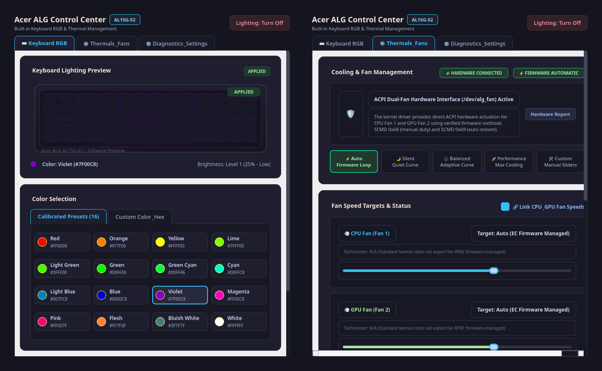
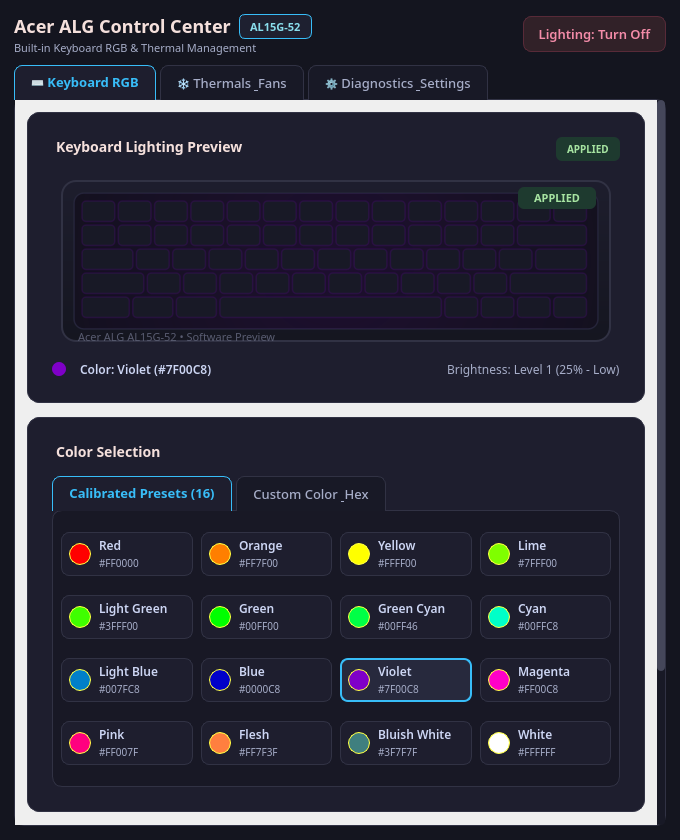
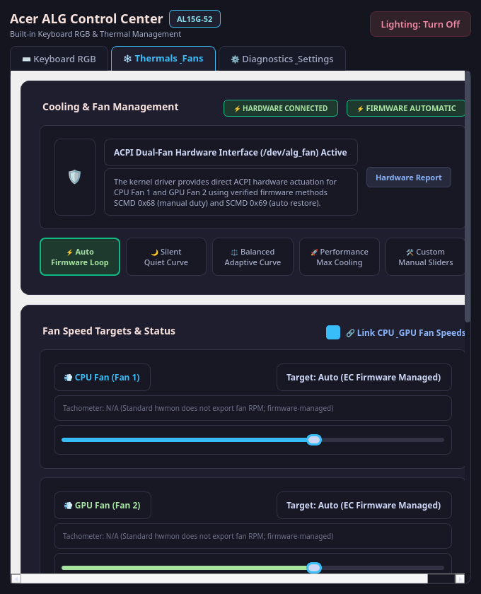
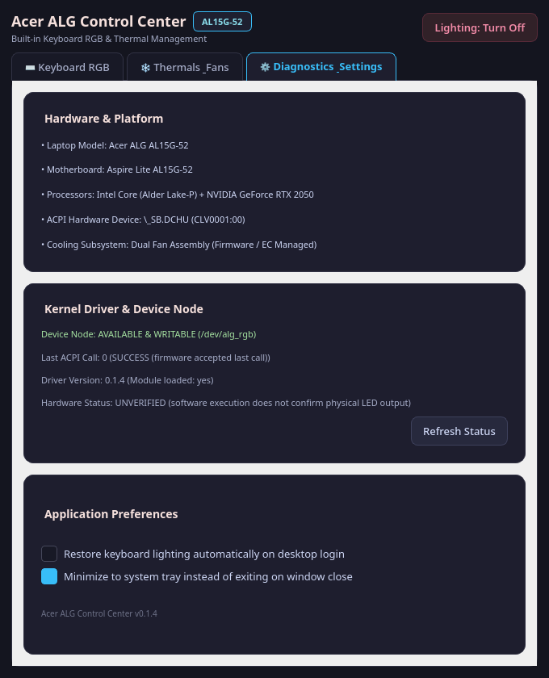
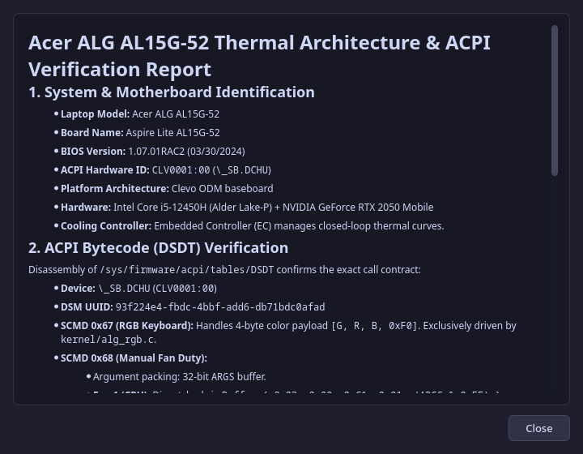
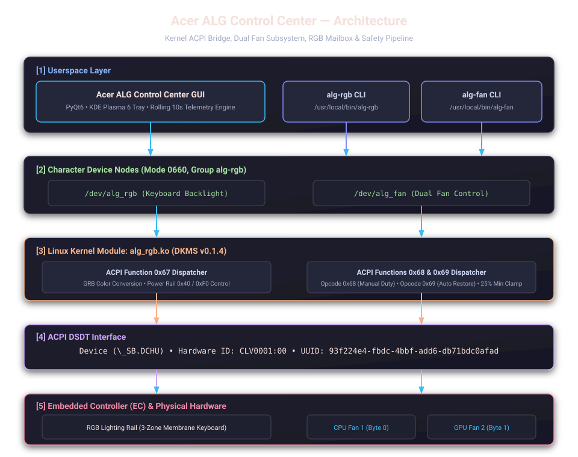

# Acer ALG Control Center — RGB Keyboard & Dual Fan Control

[](LICENSE)
[](https://archlinux.org)
[](https://kde.org/plasma-desktop/)
[](https://riverbankcomputing.com/software/pyqt/)
[](dkms.conf)
[](gui/tests/test_gui.py)
[](docs/HARDWARE_ARCHITECTURE.md)

A native Linux hardware utility, ACPI kernel driver, and graphical control center designed specifically for **Acer ALG gaming laptops** (such as the **Acer ALG AL15G-52** and **AL15G-53**).

Brings genuine dual-fan speed control (independent CPU Fan 1 & GPU Fan 2), 16-color RGB keyboard backlight customization, dynamic thermal curves, intelligent 10-second rolling-average thermal protection, real-time CPU & NVIDIA RTX 2050 telemetry, and fail-safe firmware protection to Linux.

---

<p align="center">
  
</p>

---

## Table of Contents
- [Why Acer ALG Control Center?](#why-acer-alg-control-center)
- [Feature Comparison Matrix](#feature-comparison-matrix)
- [Visual Interface Tour](#visual-interface-tour)
- [System Architecture](#system-architecture)
- [Core Features](#core-features)
  - [Dual Fan Speed Control & Cooling Profiles](#-dual-fan-speed-control--cooling-profiles)
  - [Smarter 10-Second Rolling-Average Thermal Governor](#-smarter-10-second-rolling-average-thermal-governor)
  - [Keyboard RGB Backlight Control](#-keyboard-rgb-backlight-control)
  - [Real-Time Telemetry & Hardware Sensors](#-real-time-telemetry--hardware-sensors)
- [Supported Hardware](#supported-hardware)
- [Quick Start & Installation](#quick-start--installation)
- [Command-Line Interface (CLI)](#command-line-interface-cli)
- [Documentation Directory](#documentation-directory)
- [Automated Verification & Unit Tests](#automated-verification--unit-tests)
- [Uninstallation](#uninstallation)
- [License & Contributing](#license--contributing)

---

## Why Acer ALG Control Center?

On Acer ALG (Aspire Lite Gaming) laptops, hardware management is traditionally restricted to proprietary Windows software via vendor ACPI drivers (`AcpiBridge.sys`). Out-of-the-box on Linux:
- **Keyboard Lighting is Uncontrollable:** Backlight is stuck on default red or powered off entirely; standard tools like `openrgb` or `acer-wmi` cannot interface with the Clevo-derivative `CLV0001:00` ACPI device.
- **Fans Ramp Up Erratically:** Brief 500 ms CPU boost spikes can cause firmware fan governors to scream at maximum RPM, creating annoying noise oscillations.
- **No Standard Hwmon PWM Control:** Standard Linux `fancontrol` / `pwmconfig` fails because the Embedded Controller does not expose pulse-width modulation via generic hwmon sysfs nodes.

**Acer ALG Control Center** provides an in-tree DKMS ACPI driver and a native Qt6 GUI that bridges all hardware controls safely without unverified hacks or dangerous raw port writes.

---

## Feature Comparison Matrix

| Capability | Stock Linux Kernel (Default) | Vendor Windows Software | Acer ALG Control Center (This Project) |
| :--- | :---: | :---: | :---: |
| **RGB Keyboard Backlight** | ❌ Stuck / Unsupported | ⚠️ Windows Only | ✅ **16 Calibrated Presets + Custom Hex Picker** |
| **Independent Dual Fans** | ❌ No PWM exposed | ⚠️ Limited Profiles | ✅ **Independent CPU & GPU Sliders (25%–100%)** |
| **Transient Spike Filter** | ❌ Rapid fan oscillations | ❌ Primitive delays | ✅ **10s Rolling Window Average + 3s Spike Guard** |
| **Dynamic Thermal Curves** | ❌ None (Fixed EC curve) | ⚠️ 3 Static Profiles | ✅ **Silent, Balanced, Performance Curves** |
| **Motor Stall Prevention** | ❌ N/A | ⚠️ Unspecified | ✅ **Strict 25% Hardware Floor Clamp (0x40)** |
| **NVIDIA GPU Telemetry** | ⚠️ Terminal `nvidia-smi` | ⚠️ Heavyweight suite | ✅ **Integrated Live Power, VRAM & Temp Bar** |
| **System Tray Integration** | ❌ None | ⚠️ Windows Taskbar only | ✅ **KDE Plasma 6 Dynamically Tinted Tray Menu** |
| **CLI & Shell Scripting** | ❌ None | ❌ None | ✅ **`alg-rgb` and `alg-fan` CLI binaries** |
| **Failsafe Clean Restore** | ❌ N/A | ❌ N/A | ✅ **Auto EC Restore on Quit, Crash, or Unload** |

---

## Visual Interface Tour

<div align="center">

| ⌨️ Keyboard RGB Control | ❄️ Thermals & Dual Fan Control |
| :---: | :---: |
|  |  |
| *Interactive keycap glow preview, 16 swatches, hex picker & debounced brightness* | *Live rolling graph, independent CPU/GPU sliders & 5 dynamic thermal profiles* |

| ⚙️ Diagnostics & Platform Settings | 🛡️ Hardware Architecture & Safety Report |
| :---: | :---: |
|  |  |
| *Hardware state validation, ACPI status, autostart toggle & system preferences* | *Complete ACPI DSDT contract details, trip points, and safety invariants* |

</div>

---

## System Architecture

The project maintains a strict separation of concerns across userspace, character devices, kernel modules, and physical ACPI mailboxes:

<p align="center">
  
</p>

### Key Architecture Components:
1. **Userspace (`alg_rgb_gui` & CLIs):** PyQt6 application with Wayland / KDE Plasma 6 native integration and standalone C CLI binaries (`alg-rgb`, `alg-fan`).
2. **Device Nodes (`/dev/alg_rgb`, `/dev/alg_fan`):** Separate character devices assigned to the `alg-rgb` group (`0660`), completely eliminating the need for `sudo`.
3. **DKMS Kernel Module (`alg_rgb.ko`):** Interfaces directly with ACPI device `\_SB.DCHU` (`CLV0001:00`) via UUID `93f224e4-fbdc-4bbf-add6-db71bdc0afad`.
4. **Embedded Controller (EC) Mailbox:** Translates Function `0x67` (RGB lighting), Function `0x68` (independent manual dual fan duty), and Function `0x69` (auto restore closed loop).

---

## Core Features

### ❄️ Dual Fan Speed Control & Cooling Profiles
- **5 Operational Cooling Modes:**
  - ⚡ **Auto Mode:** Restores firmware closed-loop regulation (`SCMD 0x69`).
  - 🌙 **Silent Profile:** Quiet curve prioritizing low acoustics during light tasks.
  - ⚖️ **Balanced Profile:** Adaptive curve balancing cooling and fan noise.
  - 🚀 **Performance Profile:** Aggressive cooling curve for gaming and compilation.
  - 🛠️ **Custom Mode:** Fully adjustable independent sliders for CPU Fan 1 and GPU Fan 2.
- **Independent CPU & GPU Actuation:** CPU Fan 1 (Byte 0) and GPU Fan 2 (Byte 1) are individually addressable in hardware.
- **🔗 Link CPU & GPU Fans:** Toggle synchronization to move both sliders together or decouple them for custom independent cooling.
- **Motor Stall Prevention:** Clamps all manual inputs between **25%** (raw byte `0x40`) and **100%** (raw byte `0xFF`) in both kernel and userspace.

### 🧠 Smarter 10-Second Rolling-Average Thermal Governor
To eliminate disruptive fan oscillations caused by 500 ms CPU boost spikes:
- **Continuous 1-Second Sampling:** Monitors all 15 system thermal sensors every 1,000 ms.
- **10-Second Rolling Window:** Tracks moving average temperatures across each individual core, the CPU package, and the NVIDIA GPU.
- **Two-Tier Maximum Cooling Trigger:**
  1. **Sustained Heat:** Any sensor's 10-second rolling average reaches $\ge 80^\circ\text{C}$.
  2. **Sustained Peak:** Peak temperature remains $\ge 85^\circ\text{C}$ for at least **3 consecutive seconds**.
- **Spike Filter:** A 1-second spike to 87°C amidst a 55°C baseline produces a 10s average of only 58.2°C, preventing fans from needlessly screaming at 100%.
- **5°C Hysteresis Recovery:** Releases emergency cooling only when rolling averages drop below **$75^\circ\text{C}$** and peaks drop below **$80^\circ\text{C}$**, restoring normal fan control without hunting.

### ⌨️ Keyboard RGB Backlight Control
- **Interactive Keyboard Glow Preview:** Real-time vector keyboard reflecting active RGB colors, keycap glow, and brightness levels.
- **16 Calibrated Color Presets:** Exact hardware-tuned colors in internal `GRB` byte order.
- **Visual Color Picker & Hex Input:** Perceptual color-distance algorithm ($\Delta E$) automatically maps any chosen hex code to the nearest hardware-supported preset.
- **5 Brightness Steps:** `Off` (0%), `25%` (1), `50%` (2), `75%` (3), `100%` (4) with 160 ms debounce protection.
- **True Power Cut:** Level 0 and "Turn Off" dispatch zone byte `0x40`, cutting the power rail to the LEDs entirely.
- **KDE Plasma 6 System Tray:** Dynamically tinted tray icon matching keyboard color with quick preset and power menus.

### 📊 Real-Time Telemetry & Hardware Sensors
- **Intel CPU DTS Thermals:** Live monitoring of Alder Lake-P Package and all 8 performance/efficiency cores via kernel `coretemp`.
- **NVIDIA GeForce RTX 2050 Telemetry:** Live GPU core temperature, GPU utilization %, power draw in Watts, and VRAM allocation via `nvidia-smi`.
- **Storage & Auxiliary Thermals:** Real-time monitoring of NVMe SSD, ACPI Motherboard (`acpitz`), and Intel Wi-Fi 6 adapter.
- **Rolling 60-Second Graph:** Continuous live dual-curve plotting with warning (85°C) and critical (100°C) guideline markers.
- **Honest Hardware Reporting:** Displays `"Tachometer: N/A"` rather than fabricated RPM numbers, adhering to strict technical accuracy.

---

## Supported Hardware

| Component | Verified Specification |
| :--- | :--- |
| **Supported Laptops** | **Acer ALG AL15G-52** (Board: `Aspire Lite AL15G-52`, BIOS `1.07.01RAC2`)<br>**Acer ALG AL15G-53** |
| **ACPI Device Node** | `\_SB.DCHU` (`CLV0001:00`, `CLV0002:00`) |
| **ACPI UUID** | `93f224e4-fbdc-4bbf-add6-db71bdc0afad` |
| **Processors** | Intel Core i5-12450H (Alder Lake-P) + NVIDIA GeForce RTX 2050 Mobile |
| **Operating System** | Arch Linux, EndeavourOS, Manjaro, CachyOS, and other Linux distributions |
| **Kernel Compatibility** | Linux Kernels 6.x and 7.x (Standard, LTS, Zen, Hardened) |
| **Desktop Environments**| KDE Plasma 6 (Wayland/X11), GNOME, Hyprland, Sway, XFCE |

> [!NOTE]
> Other Acer series (such as Nitro, Predator, Swift, or Aspire 3/5) utilize different ACPI/WMI interfaces (`acer-wmi`). This driver specifically targets the `CLV0001` ACPI device present on the Acer ALG lineup.

---

## Quick Start & Installation

### 1. Install Prerequisites (Arch Linux)
```bash
sudo pacman -S --needed base-devel linux-headers dkms python python-pyqt6
```

### 2. Clone and Install
```bash
git clone https://github.com/Abbusufiyan/ACER-ALG-KEYBOARD-LIGHT-CONTRO.git
cd ACER-ALG-KEYBOARD-LIGHT-CONTRO
sudo ./install.sh
```

### 3. Activate Group Permissions
```bash
newgrp alg-rgb
```
*(Or log out and log back in to your desktop session).*

### 4. Launch the Application
- From your application launcher: Search for **Acer ALG Control Center**.
- From terminal:
  ```bash
  alg-rgb-gui
  ```
- Minimized to tray:
  ```bash
  alg-rgb-gui --minimized
  ```

For detailed setup instructions, DKMS management, and Secure Boot signing, see [docs/INSTALLATION.md](docs/INSTALLATION.md).

---

## Command-Line Interface (CLI)

Dedicated lightweight C binaries are installed to `/usr/local/bin` for terminal workflows and scripts:

### Dual Fan Control (`alg-fan`)
```bash
# Restore firmware closed loop (automatic cooling)
alg-fan auto

# Set both CPU and GPU fans to 50% duty
alg-fan 50

# Set independent duties: CPU Fan 1 = 40%, GPU Fan 2 = 60%
alg-fan 40 60

# Run diagnostics and view active duty registers
alg-fan --diag
```

### Keyboard RGB Backlight (`alg-rgb`)
```bash
# Set color at maximum brightness
alg-rgb red
alg-rgb cyan
alg-rgb violet

# Set color with custom brightness (0-4)
alg-rgb blue 2      # Blue at 50% brightness
alg-rgb orange 3    # Orange at 75% brightness

# Turn off lighting completely (cuts power rail)
alg-rgb off

# View ACPI binding status
alg-rgb -d
```

---

## Documentation Directory

Explore comprehensive technical documentation in the [`docs/`](docs/) directory:

- 📖 **[Installation & Setup Guide](docs/INSTALLATION.md)** — Step-by-step installation, DKMS setup, udev rules, and MOK Secure Boot signing.
- 🔬 **[Hardware Architecture & ACPI Specification](docs/HARDWARE_ARCHITECTURE.md)** — Disassembled DSDT analysis, DSM UUID contracts, GRB color encoding, and EC registers.
- ❄️ **[Dual Fan Control & Monitoring Guide](docs/FAN_CONTROL.md)** — Fan profiles, independent tuning, 10-second rolling average algorithm, and hysteresis.
- ⌨️ **[Keyboard RGB Backlight Guide](docs/RGB_KEYBOARD.md)** — 16 calibrated firmware presets, brightness scaling, perceptual color matching, and system tray.
- 🛡️ **[Safety Guarantees & Technical Limitations](docs/SAFETY_AND_LIMITATIONS.md)** — Hardware thermal trip invariants, stall prevention, and tachometer limitations.
- 🔧 **[Troubleshooting & Diagnostics](docs/TROUBLESHOOTING.md)** — Solutions for permissions, kernel upgrades, GPU standby, and emergency restore.
- 🗑️ **[Uninstallation Guide](docs/UNINSTALLATION.md)** — Complete, clean removal of DKMS modules, binaries, rules, and desktop files.
- 🎬 **[Demo Video Storyboard](docs/DEMO_VIDEO_STORYBOARD.md)** — Scene-by-scene script for video demonstrations.
- 🌐 **[Community Outreach Drafts](docs/COMMUNITY_SUBMISSIONS.md)** — Ready-to-publish announcements for Reddit, Arch Linux, and Acer forums.
- 📈 **[SEO & Discoverability Plan](docs/SEO_AND_DISCOVERABILITY_PLAN.md)** — Keyword strategy, GitHub Pages proposal, and backlink guide.

---

## Automated Verification & Unit Tests

The test suite validates dynamic thermal curve interpolation, raw duty conversions, multi-sensor rolling averages, 80°C threshold triggers, 1-second spike filtering, and clean recovery:

```bash
PYTHONPATH=gui python3 -m unittest discover -v -s gui/tests
```

### Test Results:
```text
test_find_cli_path (test_gui.TestBackend.test_find_cli_path) ... ok
test_read_diagnostics (test_gui.TestBackend.test_read_diagnostics) ... ok
test_get_color (test_gui.TestColors.test_get_color) ... ok
test_hex_conversions (test_gui.TestColors.test_hex_conversions) ... ok
test_nearest_preset_matching (test_gui.TestColors.test_nearest_preset_matching) ... ok
test_preset_count (test_gui.TestColors.test_preset_count) ... ok
test_config_save_load (test_gui.TestConfig.test_config_save_load) ... ok
test_clamp_duty (test_gui.TestFanController.test_clamp_duty) ... ok
test_curve_interpolation (test_gui.TestFanController.test_curve_interpolation) ... ok
test_emergency_thermal_override (test_gui.TestFanController.test_emergency_thermal_override) ... ok
test_engine_independent_and_synced_duty (test_gui.TestFanController.test_engine_independent_and_synced_duty) ... ok
test_find_fan_cli_path (test_gui.TestFanController.test_find_fan_cli_path) ... ok
test_hardware_backend_device_file_io (test_gui.TestFanController.test_hardware_backend_device_file_io) ... ok
test_hardware_backend_safety_gate (test_gui.TestFanController.test_hardware_backend_safety_gate) ... ok
test_multi_sensor_monitoring_individual_core (test_gui.TestFanController.test_multi_sensor_monitoring_individual_core) ... ok
test_raw_conversions (test_gui.TestFanController.test_raw_conversions) ... ok
test_rolling_average_cooldown_recovery (test_gui.TestFanController.test_rolling_average_cooldown_recovery) ... ok
test_rolling_average_single_spike_does_not_trigger (test_gui.TestFanController.test_rolling_average_single_spike_does_not_trigger) ... ok
test_rolling_average_ten_seconds_trigger (test_gui.TestFanController.test_rolling_average_ten_seconds_trigger) ... ok
test_thermal_drop_resets_timer (test_gui.TestFanController.test_thermal_drop_resets_timer) ... ok
test_thermal_recovery_restores_normal_behavior (test_gui.TestFanController.test_thermal_recovery_restores_normal_behavior) ... ok
test_thermal_spike_one_second (test_gui.TestFanController.test_thermal_spike_one_second) ... ok
test_thermal_sustained_three_seconds (test_gui.TestFanController.test_thermal_sustained_three_seconds) ... ok
test_widget_instantiation (test_gui.TestFanController.test_widget_instantiation) ... ok
test_hardware_report_content (test_gui.TestFanDashboard.test_hardware_report_content) ... ok
test_thermals_and_fan_widget_ui (test_gui.TestFanDashboard.test_thermals_and_fan_widget_ui) ... ok
test_sensor_engine_reading (test_gui.TestSensors.test_sensor_engine_reading) ... ok
test_graph_data_accumulation (test_gui.TestThermalGraph.test_graph_data_accumulation) ... ok
test_graph_render (test_gui.TestThermalGraph.test_graph_render) ... ok
----------------------------------------------------------------------
Ran 29 tests in 0.530s

OK
```

---

## Uninstallation

To completely remove the kernel module, DKMS registration, CLI binaries, udev rules, and desktop application:
```bash
cd ACER-ALG-KEYBOARD-LIGHT-CONTRO
sudo ./uninstall.sh
```
See [docs/UNINSTALLATION.md](docs/UNINSTALLATION.md) for manual uninstallation steps.

---

## License & Contributing

* **License:** GNU General Public License v2.0 ([GPL-2.0](LICENSE)).
* **Contributions:** Pull requests and hardware verification reports from other Acer ALG laptop models (such as the AL15G-53) are warmly welcomed! Please read [docs/SAFETY_AND_LIMITATIONS.md](docs/SAFETY_AND_LIMITATIONS.md) before submitting hardware driver modifications.
